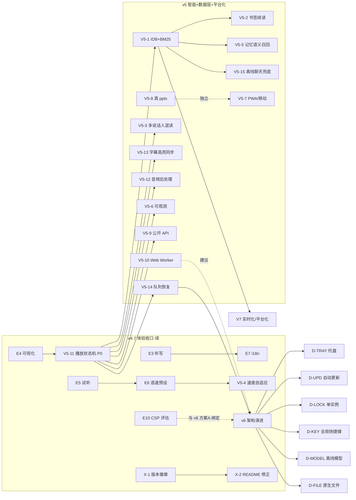

# 下一步改进指南 — v4.6.3 → v4.7 → v5 → v6 → v7 → v8+ 全栈迭代升级路线图（第二版）

> **文档定位**：**仅改进指南，不含任何代码实现**。本文件供下游执行 AI / 开发者按节点落地闭环。用户明确要求“只需要文档，不需要你改代码，因为我喜欢用其他的 AI 去改”。
> **生成时间**：2026-09-17
> **基线版本**：**v4.6.3**（`VERSION` 真源 = `4.6.3`；2026-09-15 台账 101/101 PASS；**2026-09-17 单元 8 套件真实复跑 50/50 PASS**，见 §1.1）
> **升级目标**：**v4.6.3（现状）→ v4.7（体验收口·续）→ v5（智能 + 数据层 + 平台化）→ v6（生态 + AI 原生 + 桌面深化）→ v7（平台化 + 实时化）→ v8+（远期前瞻）**
> **方法论**：第一性原理拆解 → 真根因分析（现象→直接原因→根本原因→影响面→归属）→ 多方案评估（可行性/成本/维护/性能/扩展性/风险/可衍生性/UI-UX 可观性）→ 节点化落地 + TDD 清单（RED→GREEN→REFACTOR）+ 验收标准 + 风险披露 + 阶段门禁。**严禁假实现：任何“已完成”必须有可执行代码 + 可复现命令 + 真实输出。**
> **证据等级约定**（全文标注，禁止下游引用未标注结论）：
> - `已验证`：有真实运行命令 + 真实输出（测试全绿 / 实测数字 / 浏览器实采）
> - `静态确认`：直读生产代码 / 配置文件（未运行）
> - `合理推断`：基于已验证事实的逻辑推导
> - `待验证`：需真机 / 联网 / 外部环境才能确认，**不得当作已完成**
>
> **本版与历史指南的关系（重要，防冲突）**：
> - `优化计划/下一步改进指南.md`（2026-09-15，v4.5 基线，850 行）= 上一版主指南，覆盖 v4.5→v7+；其中 **E1/E2/E8/E9/P-1/V5-9 预埋已在 v4.6/v4.6.1/v4.6.2/v4.6.3 落地**（见 `workflow_status.md` §11-§14）。
> - **本版以 v4.6.3 为真实基线重写并前移至 v8**：未落地的旧节点（E3/E4/E5/E6/E7/E10、V5-1…V5-10、v6 桌面/生态）**合并进新版批次统一编号**，并新增 P-13…P-20 根因与 V5-11…V5-15、v6/v7 新节点。
> - **下游执行 AI 以本版为准**；旧版保留在 `优化计划/` 供历史追溯，不删除。

---

## 目录

- [〇、第一性原理：这个产品的本质是什么](#〇第一性原理这个产品的本质是什么)
- [〇·二、v4.6.3 真实基线盘点（已落地能力矩阵与未闭环项）](#〇二v463-真实基线盘点已落地能力矩阵与未闭环项)
- [〇·三、根因分析：20 条真问题（含新增 P-13…P-20）](#〇三根因分析20-条真问题含新增-p-13p-20)
- [一、TDD 总清单（先测试后实现，贯穿所有节点）](#一tdd-总清单先测试后实现贯穿所有节点)
- [二、v4.7「体验收口·续」批次（E3-E7 + E10）](#二v47体验收口续批次e3-e7--e10)
- [三、v5「智能 + 数据层 + 平台化」（V5-1 … V5-15）](#三v5智能--数据层--平台化v5-1--v5-15)
- [四、v6「生态 + AI 原生 + 桌面深化」](#四v6生态--ai-原生--桌面深化)
- [五、v7「平台化 + 实时化」](#五v7平台化--实时化)
- [六、v8+ 远期前瞻探索](#六v8-远期前瞻探索)
- [七、横切关注点（每版本持续推进）](#七横切关注点每版本持续推进)
- [八、版本路线图总表](#八版本路线图总表)
- [九、执行顺序与依赖图](#九执行顺序与依赖图)
- [十、验收红线（每版本必须满足）](#十验收红线每版本必须满足)
- [十一、待验证项（外部受限，需真机/联网/用户）](#十一待验证项外部受限需真机联网用户)
- [十二、风险登记册](#十二风险登记册)
- [十三、旧产物清理与归档规范（屎山治理）](#十三旧产物清理与归档规范屎山治理)
- [十四、验收台账模板](#十四验收台账模板)
- [附录：下游落地前自检清单](#附录下游落地前自检清单)

---

## 〇、第一性原理：这个产品的本质是什么？

### 1. 产品本质

**给“想听不想看”的人一个零门槛的纯前端“聊天 + 朗读”工具。** 三个闭环（① AI 聊天回复可一键朗读；② 任意文本转语音；③ 整页内容朗读）必须在 **无注册、无 API Key、纯前端、可静态托管、离线可用** 的约束下成立。这是产品护城河，也是所有架构决策的裁判。

### 2. 真实用户是谁（决定优先级）

| 用户群 | 核心诉求 | 对应能力 | 升级权重 |
|--------|---------|---------|---------|
| 小白/普通用户 | “点一下就能听，坏了知道怎么办” | 按钮反馈、降级提示、重试、听写输入 | 极高 |
| 视障/老人/开车/家务场景 | 长文听书、断点续读、语速自适应 | 书签续读、字幕高亮、速度自适应 | 高 |
| 内容创作者 | 配音、PPT/电商文案、多说话人 | 场景向导闭环（真 .pptx）、对话混读、音频导出 | 高 |
| 开发者/被嵌入方 | 把朗读能力嵌进自己页面 | 公开朗读 API、postMessage、origin 白名单 | 中 |
| 桌面用户 | 双击即用、托盘常驻、全局快捷键 | Tauri 深化 | 中 |

### 3. 什么绝对不能动（红线）

1. **纯前端 / 无构建 / 静态托管**：`demo.html`（或 `demo.html + app.js`）必须能直接丢到静态服务器就跑，不得依赖 `npm run build`。
2. **离线可用**：断网后闭环②仍能出声（浏览器引擎/本地 WASM 兜底），这是 `sw.js` + 四级降级链存在的意义。
3. **免费优先**：默认不引入付费 S3/云存储/付费 TTS 端点；自备端点只作为用户可选高级项。
4. **不破坏既有用户数据**：localStorage 键（`tts_cfg_v1` / `tts_history_v2` / `tts_timeline_v1` / `tts_memory_v1` / `tts_wizard_v1` / `tts_health_pool_v1` 等）迁移必须幂等且失败不删旧。
5. **测试全绿才发版**：现有 **101 项**（E2E 51 + 单元 50）是回归保护名单，任何版本不得低于此基线。

### 4. 增长引擎（升级的发力点）

- **听感**：在线高质量端点（用户自备）+ 离线本地中文 WASM（引擎1.5）+ 音频后处理（归一/降噪）。
- **内容获取**：语音订阅源（RSS 播客）、实时翻译朗读、AI 摘要朗读——让“没内容可听”变成“万物可听”。
- **数据资产**：历史 IndexedDB + BM25 全文检索、书签续读、记忆语义召回——用得越久越好用。
- **平台化**：公开朗读 API、桌面深化——从“一个页面”变成“一个能力”。

---

## 〇·二、v4.6.3 真实基线盘点（已落地能力矩阵与未闭环项）

### 2.1 文件与规模（`静态确认`，2026-09-17 本机实测）

| 文件 | 行数/体积 | 备注 |
|------|----------|------|
| `demo.html` | **2748 行 / 158096 字符** | 主文件，全部 HTML/CSS/JS 内联；gzip 约 48.3KB（v4.6 记录值）|
| `dist/index.html` | 与 demo.html 同源 | CI 强制 diff 校验 |
| `sw.js` | 143 行 | Service Worker：同源 NetworkFirst + 跨域 uncloseai.com SWR |
| `engines/kokoro-js.mjs` | 2135146 B | 本地中文 WASM 引擎（vendored，同源兜底）|
| `engines/pinyin-pro.mjs` | 467996 B | 拼音→IPA 音素器（vendored）|
| `tts-zh.js` | 167 行 | Node 可测中文音素器/voice 表（与 demo.html 内联版**双实现**）|
| `src-tauri/` | Tauri 2 | 桌面壳，MSI + NSIS 双打包；`frontendDist=../dist` |
| 测试 | 9 E2E + 8 单元 = **101 项** | 见 §1.1 |
| `.github/workflows/ci.yml` | 5 阶段 | Build+dist 同步 / Quality / Test 分片 / Security / Deploy Pages+Release |

> 注意：`优化计划/下一步改进指南.md`（旧版）记录的 2657 行是 v4.6.0 快照；本版 2748 行。

### 2.2 已落地能力矩阵（`已验证` = 台账复跑；`静态确认` = 代码直读）

| 能力 | 关键实现/标识符 | 证据 |
|------|----------------|------|
| 三闭环（聊天 / 任意文本 TTS / 整页朗读） | `#chat` uncloseai widget / `speak()` / `read-page-btn` | `已验证` |
| 四级降级链 | 引擎1 在线 F5-TTS → 引擎1.5 本地中文 WASM（Kokoro+pinyin-pro）→ 引擎2 浏览器 `speechSynthesis` → 引擎3 文本兜底（复制）| `静态确认`，真机出声待验证 |
| E1 SSML 子集 | `parseSSML` / `SSML_ALLOWED`（break/prosody/emphasis）+ 属性校验 + 停顿转段落 + 韵律系数 | `已验证`（U_SSML 3 + T_SSML 3）|
| E2 分块增强 | `splitIntoChunks`：段落边界禁止合并 + 超长硬切回退英文词边界 + 无损 | `已验证`（U_SPLIT 4 + T_SPLIT 1）|
| 配置中心 | `tts_cfg_v1` / `loadCfg`/`saveCfg`/`exportCfg`/`importCfg` / UncloseVault AES-256 API Key | `已验证`（U_CFG 8 + T_CFG 5）|
| 多端点健康自愈池 | `healthPoolInit` / `tts_health_pool_v1` / 冷却 TTL + 自动复活 + 429 降并发 | `已验证`（A2_1-5）|
| 透明时间线 | `pushTimeline` / `tts_timeline_v1` 环形 200 条 + 脱敏 + 导出 | `静态确认` |
| 记忆三层 + 画像 + 技能结晶 | `memoryLoad`/`memoryRecord`/`memoryCrystalSuggestions` / `tts_memory_v1` | `已验证`（B1_1-4）|
| 场景向导 B3/B4/B5 | `wz-*`（看板五态流转 / PPT 大纲+几何审计 / 电商三稿+禁用词）| `已验证`（WZ_1-6 + T_WZ_1-6）|
| 并发合成池 | `pLimit(3)` + 429 降 max=2 + 指数退避 + 按序播放 | `已验证`（U_POOL_1-4）|
| 主题三态 + 语速持久化 | `theme-btn` / `applyTheme` / `speed-slider` / `matchMedia` | `静态确认` |
| 朗读高亮 | `hlStart`/`hlAdvance`/`hlClear`（按块定时间隔）| `静态确认`（V5-13 将升级为按发音时长）|
| PWA + SW 离线 | `sw.js` 注册 + NetworkFirst + 跨域 SWR | `已验证`（T_SW_1-3）|
| 版本真源 | `VERSION` + `verify-acceptance.cjs --strict` 四处一致校验 | `已验证`（101/101）|
| E8 无障碍门禁 | `e2e-test-a11y.cjs`（axe WCAG2 A/AA，serious/critical 零容忍）+ `--danger-ink` 对比度修复 | `已验证`（T_A11Y_1-4）|
| E9 性能预算 | `e2e-test-perf.cjs`：FCP<1.5s / CLS<0.1 / gzip<60KB / LCP 护栏<8s | `已验证`（T_LH_1-4）|
| 可用性门禁 | `e2e-test-avail.cjs`：第三方挂起时应用仍可用 | `已验证`（4/4）|
| V5-9 预埋 | `window.__chattts = { version, splitIntoChunks, parseSSML }` | `静态确认` |
| 桌面壳 | `src-tauri`（Tauri 2，MSI+NSIS）| `静态确认`，发布包在 `发布/` |

### 2.3 已落地但未闭环 / 待验证项（诚实披露，不得当作已完成）

1. **引擎1.5 真机出声未验证**（结构性前提）：headless Chromium 无法跑 82MB WASM 推理；真机路径 = ⚙️ 引擎1.5 自检（依赖可达）→ 朗读中文（出声复验）。`待验证`。
2. **在线端点 `speech.ai.unturf.com` 长期 502**：降级链兜底，在线高质量仍依赖用户自备端点。`合理推断`为长期状态。
3. **iOS Safari / 移动端触摸未真机验证**：WASM 内存限制 + autoplay + touch 手势均 `待验证`。
4. **E3 语音听写 / E4 音频可视化 / E5 语音试听 / E6 语速预设 / E7 i18n / E10 CSP 收敛**：**未落地**（`静态确认`，demo.html 中无对应实现）。
5. **PPT 向导导出是 Markdown 文本**，非二进制 `.pptx`；电商向导无真实发布动作。
6. **历史 / 记忆 / 画像 / 看板全部 localStorage**：无跨设备、无 IndexedDB、无全文检索。
7. **CSP 含 `'unsafe-inline'` + `'unsafe-eval'`**：前者因 uncloseai.js 内联配置，后者为 WASM 必需（见 §2.4 节点 E10）。
8. **导航徽章显示 “v4.6”** 而真源是 4.6.3（版本展示漂移，见 P-1 残余）。
9. **`playBlob('error')` 在引擎1 循环中不中断**，可能把“播放失败”误报为“播放完毕”（见 P-13）。

### 2.4 降级链与关键常量速查（改引擎必读）

| 项 | 值 | 位置 |
|----|----|------|
| 默认在线端点 | `https://speech.ai.unturf.com/v1/audio/speech` | `TTS_ENDPOINT` |
| 语音列表端点 | `https://speech.ai.unturf.com/v1/voices` | `VOICES_ENDPOINT` |
| 默认模型 | `tts-1-f5` | `TTS_MODEL` |
| 最大字符 / 分块 | `MAX_CHARS=5000` / `CHUNK_SIZE=500` | 常量 |
| 本地中文引擎 | CDN `kokoro-js@1.2.1` + `pinyin-pro@3.28.2` → 同源 `engines/*.mjs` 兜底 | `KOKORO_ESM` 等 |
| 模型 | `onnx-community/Kokoro-82M-v1.0-ONNX`，默认音色 `zf_xiaobei` | 常量 |
| 存储键 | `tts_cfg_v1` / `tts_history_v2` / `tts_voice_v2` / `tts_theme_v2` / `unclose_real_model_v2` / `tts_timeline_v1` / `tts_memory_v1` / `tts_wizard_v1` / `tts_health_pool_v1` | 常量 |
| 公开 API | `window.__chattts`（只读工具，E2E 断言依赖）| demo.html |
| 第三方聊天库 | `https://uncloseai.com/uncloseai.js` 非阻塞动态注入（v4.6.2 根因修复）| head 脚本 |

---

## 〇·三、根因分析：20 条真问题（含新增 P-13…P-20）

> 每条给“现象 → 直接原因 → 根本原因 → 影响面 → 归属节点”。**根因分析优先于方案选择**：不解决根因的方案注定复发。P-1…P-12 为旧版延续（标注当前状态）；P-13…P-20 为本版新增。

| # | 现象 | 直接原因 | **根本原因** | 影响面 | 归属 |
|---|------|---------|-------------|--------|------|
| **P-1** | 版本号多处写死（`VERSION`/`package.json`/`tauri.conf.json`/`__chattts.version` 已统一，但**导航徽章仍是 “v4.6”**）| 徽章未读真源 | 版本真源治理只覆盖“校验位”，**展示位未接入** | 用户看到旧版本号 | v4.7（横切）|
| **P-2** | 文档数字漂移（README 台账门槛写 “E2E≥47” 而实测 E2E=51）| 发版后未回写所有文档 | 文档无机器可校验的一致性门禁（`--strict` 只校验四处版本，不校验 README 数字）| 下游读到旧数字做错决策 | v4.7（横切）|
| **P-3** | 引擎1.5 真机出声未知 | headless 无法跑 WASM 推理 | 验证环境与被验证路径不匹配 | L1 体验风险悬置 | v4.7（P0-1-A/B）|
| **P-4** | 在线高质量依赖他人端点（默认端点长期 502）| 默认端点宕机 | 无自托管落地路径（用户不知如何自建端点）| L3 可用性被外部决定 | v4.7（P0-1-A 文档）|
| **P-5** | 内联音素器与 `tts-zh.js` 双实现 | 为让 Node 可单测而复制 | 测试可测性驱动实现重复 | 改一处忘另一处 → 漂移 bug | v6（模块化）+ v4.7（同步断言）|
| **P-6** | 单文件 2748 行、gzip 48KB | 全部内联 | “单文件部署承诺”与“可维护性”的根本张力 | 演进速度下降 | v6（架构演进）|
| **P-7** | 场景向导产出停在半成品（PPT 只导 .md）| 为守“无重依赖”牺牲闭环深度 | 缺浏览器端真实产物生成方案 | 用户觉得“玩具” | v5（V5-8，pptxgenjs 已验证可浏览器直出 .pptx）|
| **P-8** | 无 i18n（E7 未落地）、无障碍仅基础门禁 | 未规划 | 早期只服务中文单场景 | 全球化受阻 | v4.7（E7）|
| **P-9** | 数据全在 localStorage（~5MB 上限、无索引、无检索）| 直接用了 localStorage | 未做数据层抽象 | 数据越用越憋 | v5（V5-1/V5-5）|
| **P-10** | 性能基线不全（FCP/CLS 已测；LCP 被第三方主导 5768ms）| 第三方 widget 是黑盒 | 首屏真实可交互时间被远程黑盒决定 | 弱网/离线首屏差 | v4.7（E9 深化：懒加载/占位）|
| **P-11** | CSP 含 unsafe-inline/unsafe-eval | uncloseai.js 内联配置 + WASM | 第三方黑盒库 + WASM 生态的固有约束 | 安全评分被扣 | v4.7（E10）|
| **P-12** | 测试矩阵单一（只测桌面 Chromium）| 无多浏览器/多设备 | 覆盖盲区 | iOS/移动回归无感 | v4.7 + v5（V5-7）|
| **P-13** ⭐新增 | 音频播放出错时状态栏仍可能显示“播放完毕/离线朗读完毕” | 引擎1 循环里 `playBlob` 返回 `'error'` 时不 break，直接播放下一块，最后 `return 'ok'`；`speak()` 只区分 `stopped/blocked/ok/fallback` | **播放状态机缺少“失败”终结态**（`'error'` 与 `'ended'` 混为一谈）| 用户听到一半失败却被提示成功 → 信任崩塌 | v5（V5-11，P0）|
| **P-14** ⭐新增 | 播放/竞态控制分散在全局互斥变量（`isStopped` / `speakRequestId` / `isSynthesizing` / `currentEngine` / `audioBlobs` / `progressEl` / `hlTimer`）| 逐处手写 `myId !== speakRequestId` 守卫 | **无单一播放状态机**，状态转移靠人肉同步 | 新功能（暂停/跳段/续读/混读）越加越容易出竞态 | v5（V5-11）|
| **P-15** ⭐新增 | 错误处理一把抓：`logError(e.message, tag)` 无错误分类/聚合 | 无错误 taxonomy | 失败原因无法聚合 TopN、无法给用户可执行建议 | 排障靠人肉翻时间线 | v5（V5-6）|
| **P-16** ⭐新增 | 长文合成/解析在主线程执行（无 Web Worker）| 单文件内联 | 未考虑计算密集任务下 UI 卡顿 | 长文/大模型下载时按钮无响应 | v5（V5-10）|
| **P-17** ⭐新增 | 桌面版与网页版功能漂移 | Tauri 只是静态壳 | 无桌面能力层（托盘/文件拖拽/离线模型内置/全局快捷键）| 桌面用户价值未兑现 | v6（桌面深化）|
| **P-18** ⭐新增 | 高亮用固定间隔推进（`hlAdvance` 定时器）| 无发音时长数据 | 块时长估算缺失 | 高亮与声音不同步 | v5（V5-13）|
| **P-19** ⭐新增 | 无“播放队列”概念：stop 后无法恢复、无跳段/倍速段 | 播放即整段合成循环 | 数据层（历史/书签）与播放层未打通 | 长文听书体验断档 | v5（V5-14）|
| **P-20** ⭐新增 | 聊天能力完全依赖 uncloseai 在线库，离线时聊天无兜底 | 无聊天缓存/离线 FAQ | 未考虑“离线时聊天仍可用” | 断网时闭环①失效 | v5（V5-15）|

> **矛盾显式化**：本项目的“**无构建 / 单文件 / 纯前端**”是护城河，但它同时是 **P-5 / P-6 / P-9 / P-16** 的母因。**结论不是打破它，而是用“开发期模块化 + 产物单文件化”取最优**（v6 架构演进，§4.3）。同时 **P-13/P-14 是体验与信任级缺陷，建议在 v5 第一优先级处理，不因“没坏就修”而拖延。**

---

## 一、TDD 总清单（先测试后实现，贯穿所有节点）

### 1.1 测试基础设施（v4.6.3 已建好，**101 项全绿**）

| 类别 | 文件 | 项数 |
|------|------|------|
| E2E 主套件 | `e2e-test.cjs` | T1-T17 = **17** |
| E2E SW | `e2e-test-sw.cjs` | T_SW_1-3 = **3** |
| E2E 配置中心 | `e2e-test-cfg.cjs` | T_CFG_1-5 = **5** |
| E2E 引擎1.5 | `e2e-test-zh.cjs` | T_ZH_1-4 = **4** |
| E2E 场景向导 | `e2e-test-wizard.cjs` | T_WZ_1-6 = **6** |
| E2E SSML/分块 | `e2e-test-ssml.cjs` | T_SPLIT_1 + T_SSML_1-3 = **4** |
| E2E 无障碍 | `e2e-test-a11y.cjs` | T_A11Y_1-4 = **4** |
| E2E 性能预算 | `e2e-test-perf.cjs` | T_LH_1-4 = **4** |
| E2E 可用性 | `e2e-test-avail.cjs` | 4（第三方挂起/超时仍可用）|
| **E2E 小计** | — | **51** |
| 单元 推理清洗 | `unit-test.cjs` | U_CLEAN 7 + 22 样本夹具 |
| 单元 并发池 | `unit-test-pool.cjs` | U_POOL 4 |
| 单元 配置中心 | `unit-test-cfg.cjs` | U_CFG 8 |
| 单元 中文引擎 | `unit-test-zh.cjs` | U_ZH 9 |
| 单元 健康池 | `unit-test-health.cjs` | A2_1-5 |
| 单元 记忆三层 | `unit-test-memory.cjs` | B1_1-4 |
| 单元 场景向导 | `unit-test-wizard.cjs` | WZ_1-6 |
| 单元 SSML/分块 | `unit-test-ssml.cjs` | U_SPLIT 1-4 + U_SSML 1-3 = 7 |
| **单元小计** | — | **50** |
| **总计** | — | **101** |

**2026-09-17 本次复跑证据**（`已验证`）：

```
$ node --test unit-test.cjs unit-test-pool.cjs unit-test-cfg.cjs unit-test-zh.cjs        unit-test-health.cjs unit-test-memory.cjs unit-test-wizard.cjs unit-test-ssml.cjs
ℹ tests 50   ℹ pass 50   ℹ fail 0   （duration 1616ms）
```

> `verify-acceptance.cjs --strict` 现存门禁：E2E≥51 且 单元≥50 且 VERSION/package.json/tauri.conf.json/demo.html 四处一致（README 中“E2E≥47”为陈旧值，见 P-2，v4.7 需修正）。

### 1.2 TDD 铁则（v4.6.3 之上强化）

1. **RED 先行**：每个测试 ID 先写断言跑一次，确认 FAIL（功能未实现）。
2. **GREEN 最小实现**：写最少代码让测试转 PASS，不多做。
3. **REFACTOR**：在测试保护下重构，跑一次确认仍 PASS。
4. **回归门禁**：每完成 3 个节点跑一次全量回归（**当前基线 101 项不得回归**）。
5. **覆盖率目标**：纯逻辑单元 100%（清洗/配置/并发池/音素器/健康池/记忆/向导/分块/SSML/BM25/IDB/书签/状态机/音频后处理/i18n）；E2E 关键用户路径 100%。
6. **禁止 mock 冒充真实**：Mock 只证明隔离逻辑，不得描述为真实集成已通过。
7. **用例隔离与确定性（v4.6.3 血泪教训，继续执行）**：每个 E2E 用例**独立 page/context**，交互前**显式等应用就绪**（`window.__chattts` 就绪），断言**轮询等目标状态**而非固定 `sleep`。
8. **归因分离**：测试挂红先回答「产品缺陷还是测试缺陷」，用可复现、可对比的最小实验取证，禁止一句“flaky 重跑”了事。
9. **新增：播放状态机必须有“失败/超时/恢复”终结态断言**（P-13/P-14 直接由此抓出）；新增功能一律先补状态机测试再补 UI 测试。

### 1.3 现有测试 ID 全量索引（回归保护名单，不得删除/改名）

- **E2E 主套件 T1-T17**：页面加载 200 / 核心元素 / 端点徽章 / 降级朗读 / 字符计数 / 主题三态 / chip 回填 / Ctrl+Enter / Esc / 整页朗读 / 历史面板 / CSP 去 qwen / 推理清洗 / 品牌色 / 历史增强 / 暗色对比度 / Service Worker。
- **E2E 专项**：T_SW_1-3（跨域缓存）/ T_CFG_1-5（配置中心）/ T_ZH_1-4（引擎1.5 含自检）/ T_WZ_1-6（场景向导）/ T_SPLIT_1 + T_SSML_1-3 / T_A11Y_1-4 / T_LH_1-4 / T_AVAIL_1-4。
- **单元**：U_CLEAN 1-4+边界 / U_POOL 1-4 / U_CFG 1-8 / U_ZH 1-9 / A2_1-5 / B1_1-4 / WZ_1-6 / U_SPLIT 1-4 + U_SSML 1-3。

### 1.4 新增测试 ID 总表（本指南所有节点，按批次列出）

| 节点 | 测试 ID | RED 断言（先失败）| GREEN 标准 | 批次 |
|------|---------|------------------|-----------|------|
| E3 听写 | T_SR_1/2 | 🎤 click 后输入框出现识别文字；不支持时给可读降级 | 识别回填 + 降级文案 | v4.7 |
| E4 可视化 | T_VIZ_1/2 | 朗读时 `#viz-canvas` 像素非空；停止后清空 | 频谱渲染/停止清空 | v4.7 |
| E5 试听 | T_AUD_1 | 切换语音后触发试听播放 | audio 元素 src 变化 | v4.7 |
| E6 语速预设 | U_SPEED_1/2 + T_SPEED_1 | 预设值映射正确；朗读中拖滑块浏览器引擎即时生效 | 语速断言 | v4.7 |
| E7 i18n | U_I18N_1/2/3 + T_I18N_1 | 缺 key 回退 zh；插值替换；切英文界面全英 | 语言切换 | v4.7 |
| E10 CSP | T_CSP_1/2 | 无 `'unsafe-inline'` 违规报告；非白名单来源被拒 | nonce/hash 或外链 | v4.7 |
| 版本展示 | T_VER_1 | 导航徽章文本 == 真源版本 | 徽章读 VERSION | v4.7 |
| 播放状态机 | U_PLAY_1/2/3/4 | `'error'` 进入失败终结态且不 report ok；stop/blocked/error 三态互斥；重复 speak 竞态只保留最新；恢复续播 | 状态机断言 | v5（P0，先做）|
| V5-1 IDB | U_IDB_1/2/3 + T_HIST_1 | localStorage→IDB 迁移幂等；1000 条搜索<100ms；标签/收藏 CRUD | IDB CRUD | v5 |
| V5-1 BM25 | U_BM25_1/2/3 | 倒排构建；字段加权；归一化打分排序 | 检索命中 | v5 |
| V5-2 书签 | U_BM_1/2 + T_BM_1 | 断点写入/读取；text hash 区分多书签；文本变化提示 | 续读提示 | v5 |
| V5-3 混读 | U_DIA_1/2 + T_MULTI_1 | 说话人前缀识别；旁白默认语音；误识别门 | 自动分语音 | v5 |
| V5-4 自适应 | U_ADAPT_1/2 + T_ADAPT_1 | 文本类型→语速映射；可关闭 | 数字段慢于正文 | v5 |
| V5-5 语义召回 | U_MEM_5/6 | RRF 双通道排序；画像/偏好不衰减 | 召回加权 | v5 |
| V5-6 可观测 | U_OBS_1/2 + T_OBS_1 | 失败原因分类 TopN；统计窗口正确 | 聚合正确 | v5 |
| V5-7 移动 | T_TOUCH_1/2 | 320/375/768 视口无横向溢出；触控目标≥44px | 响应式断言 | v5 |
| V5-8 真 pptx | U_PPTX_1 + T_PPTX_1 | 导出产物魔数 `PK`；页数/要点数正确 | 真 .pptx 可打开 | v5 |
| V5-9 API | T_API_1/2 | postMessage 朗读指令；非白名单 origin 被拒 | 嵌入可用 | v5 |
| V5-10 Worker | T_WORKER_1 + U_WORKER_1 | 分块合成在 Worker 内完成；主线程无长任务 | 合成不卡 UI | v5 |
| V5-12 音频后处理 | U_AUDIO_1/2 | 峰值归一 ≤1.0；静音裁剪时长正确 | 输出波形断言 | v5 |
| V5-13 字幕同步 | T_SUB_1 | 高亮块与当前发音块一致（按时长）| 同步断言 | v5 |
| V5-14 队列恢复 | U_QUEUE_1/2 + T_RESUME_1 | 队列持久化；重启后可从断点续播 | 续播成功 | v5 |
| V5-15 聊天缓存 | U_CHAT_1/2 + T_CHAT_1 | 离线时命中缓存回答；无缓存给离线 FAQ | 降级可用 | v5 |
| v6 桌面 | T_TAURI_*（原生冒烟）| 托盘/单实例/快捷键可用 | 桌面验收 | v6 |

> **优先级铁则**：v5 第一优先级 = **U_PLAY 状态机（P-13/P-14）→ V5-1 数据层 → V5-2 书签 → 其余按依赖推进**。状态机不先落地，后续一切“可恢复/混读/跳段”功能都建在流沙上。

---

## 二、v4.7「体验收口·续」批次（E3-E7 + E10）

> **主题**：把 v4.6 未收口的体验项一次补齐；全部为**小增量、无重构**，改 `demo.html` 内联（或按 §4.3 方案 A 抽 `app.js`）。**每节点都必须满足 §1.2 铁则（RED→GREEN→REFACTOR + 回归 101 不退化）。**

### E3 · 语音听写输入（SpeechRecognition）

- **根因**：P-8/小白用户——打字门槛高，“我不会打字怎么办”是朗读工具的核心场景。
- **方案**：在 TTS 输入框旁加 🎤 按钮；点击启动 `(window.SpeechRecognition || window.webkitSpeechRecognition)`，`recognition.lang = 'zh-CN'`（跟随 i18n），`continuous=false`（单次听写，降低错词串扰）。识别结果回填 `#tts-input` 并更新字数；失败（网络/权限）给人类可读降级文案。
- **落地技术点**：`onresult` 取 `event.results[0][0].transcript`；`onspeechend`/`onerror` 统一收尾复位按钮 loading 态；**不支持的浏览器**（Firefox 桌面等）隐藏按钮或点击给 `showNotice('当前浏览器不支持语音听写，请手动输入')`（诚实降级，不假实现）。
- **验收**：`T_SR_1`（mock 识别事件 → 输入框回填）+ `T_SR_2`（不支持时降级文案）。
- **风险**：Chrome/Edge 支持良好，Safari 需 `webkitSpeechRecognition` + 用户手势；听写在 `file://` 下受限（必须 http(s)，README 已要求 8765）。
- **依赖**：无。

### E4 · 音频可视化（AnalyserNode 频谱）

- **根因**：P-10/体验——朗读时没有任何视觉反馈，用户不知道“声音真的在动”。
- **方案**：在工具栏加 `#viz-canvas`（128px 高，横贯宽度）；用 `AudioContext` + `MediaElementSource`（若浏览器允许）或**合成代理**（在无 MediaElementSource 时按播放进度模拟，诚实标注“估算模式”）绘制频率条。
- **落地技术点**：`createAnalyser` + `getByteFrequencyData` + `requestAnimationFrame` 绘制柱状条；停止/清空时 `ctx.clearRect`；`prefers-reduced-motion` 时只显示静态电平（不动画）。
- **验收**：`T_VIZ_1`（朗读时 canvas 有非空像素）+ `T_VIZ_2`（停止后清空）。
- **风险**：`MediaElementSource` 与 `createObjectURL` Audio 的兼容差异；iOS 需先 `unlockAudio()`（`speak()` 已调用，复用）。
- **依赖**：无。

### E5 · 语音试听（切换语音即听到）

- **根因**：P-8/小白用户——42+ 语音不知道选哪个，只能盲选。
- **方案**：`#voice-select` `change` 时用当前设置端点合成一段示例句（“你好，我是这个示例语音。”），播放试听；试听期间再次切换自动停止上一段。
- **落地技术点**：`change` → `fetchTTSChunk(sampleText, voice, 1)` → `playBlob`；**试听不写历史、不写记忆**；端点不可达时静默跳过（不弹错误，避免打扰选音）。
- **验收**：`T_AUD_1`（切换语音触发 audio 播放）。
- **风险**：频繁切换触发端点限流 → 试听加 300ms debounce + 复用健康池路由。
- **依赖**：无。

### E6 · 语速范围扩展 + 预设 + 每语音记忆

- **根因**：P-8/听感——滑块仅 0.5x-2x（`#speed-slider min=0.5 max=2`），无预设、无记忆。
- **方案**：范围扩到 **0.25x-4x**（`parseSSML` 的 `rateOverride` 已钳位 0.25-4，保持一致）；加预设按钮（0.75/1/1.5/2/3）；`localStorage` 记忆**每语音**上次语速（`tts_speed_<voice>`）；设置面板可关。
- **落地技术点**：在线/WASM 引擎语速在**合成时确定**，朗读中拖动需**下一段生效**（诚实文案）；仅浏览器引擎（引擎2）即时改 `.rate`。滑块 `change` 时 `saveCfg({speed})` 已具备，需加 voice 维度。
- **验收**：`U_SPEED_1/2`（范围钳位 + 预设映射）+ `T_SPEED_1`（浏览器引擎朗读中即时变）。
- **风险**：三引擎行为差异需在 UI 明示（滑块旁小字“在线/本地引擎下一段生效”）。
- **依赖**：无。

### E7 · 多语言界面 i18n

- **根因**：P-8——仅中文硬编码，无国际化基线。
- **方案**：全部硬编码文案抽到内联 `I18N = { zh:{...}, en:{...} }`（**内联，避免额外请求**）；顶栏 🌐 切换；跟随 `navigator.language`；库语言 `UNCLOSEAI_LANGUAGE` 同步；默认 TTS 语音/听写 `recognition.lang` 跟随。
- **落地技术点**：`t(key, vars)` 插值；缺失 key 回退 zh（`U_I18N_1`）；用户自定义文案覆盖（设置面板把“朗读”改成“播放”）；`data-i18n` 属性批量扫描替换（含 placeholder/aria-label/title）。
- **验收**：切英文后界面全英（`T_I18N_1`）+ U_I18N 1-3 PASS。
- **风险**：文案分散在 HTML 属性/`aria-label`/`title` 多处 → 需一次抽干，否则漏译；`uncloseai.js` 库本身有 `UNCLOSEAI_LANGUAGE` 配置，但库内文案不由本项目控制（诚实披露）。
- **依赖**：无。

### E10 · CSP 收敛（去 unsafe-inline / 收敛 unsafe-eval）

- **根因**：P-11 —— `'unsafe-inline'` 因 uncloseai.js 内联配置脚本；`'unsafe-eval'` 为 WASM 引擎1.5 必需。
- **方案（二选一，先评估不贸然改）**：
  - **方案 A（推荐渐进起点）**：把内联配置脚本（`UNCLOSEAI_*`）+ 内联 module 抽到外链 `app.js`（`<script type="module" src="app.js">`），CSP 收为 `script-src 'self' <CDN 白名单>`，**去掉 `'unsafe-inline'`**。部署变两文件（demo.html + app.js），仍是**无构建静态托管**；副作用：E10 自然落地 + P-6 缓解。
  - **方案 B（保持单文件）**：内联脚本改用 `'sha256-...'` 哈希放行；每改一次脚本需重算哈希（需脚本辅助，与“无构建”有摩擦）。
- **落地技术点**：`unsafe-eval` 收敛：引擎1.5 若能走预编译 wasm（无 eval 路径）则移除；否则保留并**在文档显式披露原因**（不假收敛）。`connect-src` 白名单随用户自备端点扩展（设置面板保存后动态追加会被 CSP 拒绝 → 需在 meta 中预置或文档说明 CSP 需同步）。
- **验收**：`T_CSP_1`（无 unsafe-inline 违规）+ `T_CSP_2`（非白名单来源被拒）。
- **风险**：外链化与“单文件”承诺有张力 → 与 v6 架构演进（§4.3 方案 A）**同期评估**，不要中间态。
- **依赖**：v6 架构演进（耦合）。

### X-1 · 版本展示真源化（P-1 残余，横切）

- **方案**：导航徽章 `v4.6` 改为读真源（`window.__chattts.version` 注入或内联常量与 `VERSION` 同源）；`verify-acceptance.cjs` 新增第 5 处校验（徽章文本）。
- **验收**：`T_VER_1` 徽章文本 == 真源版本。
- **风险**：极小；注意 `dist/index.html` 需同步（CI diff 校验已覆盖）。
- **依赖**：无。

### X-2 · README 台账数字修正（P-2 残余，横切）

- **方案**：README 测试基线表补齐 `e2e-test-avail.cjs`（4 项）并修正“台账门禁 E2E≥47”→“E2E≥51”；文件结构块补 v4.5+ 新增测试文件与 `engines/`、`计划书/`。`chat-tts-evolve.skill.md` 基线节同步到 v4.6.3/101 项。
- **验收**：全仓 grep 无陈旧数字（47/78/57 等历史声称不得混存）。
- **风险**：无。
- **依赖**：无。

---

## 三、v5「智能 + 数据层 + 平台化」（V5-1 … V5-15）

> **主题**：让数据能搜、能续、能成长；让工具能被嵌入、能自己知道自己健康；**先修体验信任（状态机），再铺数据底座**。
> **执行序**：V5-11（状态机，P0）→ V5-1（IDB+BM25）→ V5-2（书签续读）→ V5-14（队列恢复）→ V5-3/V5-4/V5-13（多说话人/自适应/字幕）→ V5-5（语义召回）→ V5-6/V5-15（可观测/离线聊天）→ V5-7（PWA/移动）→ V5-8（真 pptx）→ V5-9（公开 API）→ V5-10（Worker/流式）→ V5-12（音频后处理）。

### V5-11 · 播放状态机重构（**P0，第一优先**，修复 P-13/P-14）

- **根因**：P-13（`'error'` 静默当成功）+ P-14（全局互斥变量散落、逐处手写竞态守卫）。
- **方案**：引入单一播放状态机 `playState`，把 `isStopped / speakRequestId / isSynthesizing / currentEngine / audioBlobs / progressEl / hlTimer` 收敛为显式状态机：
  - 状态：`idle → preparing → synthesizing → playing → paused → errored → stopped → completed`
  - 转移事件：`speak() / stop() / pause() / resume() / chunk-played / chunk-error / all-done`
  - 关键不变量：**`errored` 是终结态**，任何引擎的 `playBlob` 返回 `'error'` 都必须推进到 `errored` 并在状态栏/时间线给出失败原因（不再 `return 'ok'`）；`stop()/blocked/error` 三态互斥（一次转移只落一个态）。
  - 每个块播放记录 `{blockIndex, charOffset, ts}`，喂给 V5-2/V5-14 断点续读。
  - 对外暴露 `window.__chattts.play = { state, subscribe(cb), speak(text), stop(), pause(), resume(), onStateChange }`（V5-9 公开 API 的地基）。
- **落地技术点**：纯函数状态机放内联（可被 Node 抽取单测，参照 `tts-zh.js` 双实现模式）；`speak()` 只做“输入校验 + 目标态转移 + 日志”，不再直接改 8 个变量。
- **验收**：`U_PLAY_1/2/3/4`（error 终结态 / 三态互斥 / 竞态只保留最新 / 恢复续播）+ 全量回归 101 不退化。
- **风险**：改动面大（`speak/synthChain/playBlob/synthWithBrowser/synthWithZhWasm` 全要过状态机）→ **必须 RED 先行 + 每步回归**，禁止一把梭。
- **依赖**：无（先做）。

### V5-1 · IndexedDB 历史升级 + BM25 全文检索

- **根因**：P-9 —— 历史仅 20 条 localStorage，无标签/收藏/检索/分页。
- **方案**：历史迁移到 IndexedDB（容量近乎无限）；字段 `id/text/voice/speed/ts/tags[]/favorite/engine/duration/ssml`；**纯前端 BM25 倒排索引**（零依赖）做全文检索；`navigator.storage.persist()` 申请持久化（不支持则跳过）。
- **落地技术点**：
  1. 首次启动把 `tts_history_v2` 旧历史**迁移**到 IDB（幂等，失败可重试，**失败不删旧**）。
  2. 虚拟滚动（只渲染可见项），10000 条不卡。
  3. 检索：BM25 字段加权（text 高权重）+ 倒排候选集剪枝 + 归一化三权重（`0.4*recency + 0.3*access + 0.3*type`）+ RRF 融合。
  4. 导出 JSON + CSV；收藏置顶；时间范围过滤。
- **验收**：1000 条历史搜索 < 100ms（`T_HIST_1`）；U_IDB 1-3 + U_BM25 1-3 PASS。
- **风险**：存储配额（WASM 模型 82MB 与历史争额）；迁移失败丢数据 → 迁移失败不删旧。
- **依赖**：无（纯前端）。

### V5-2 · 书签 + 断点续读

- **根因**：P-19 前置——长文朗读中断后只能从头再来。
- **方案**：播放状态机每块完成记录当前位置（按 **text hash** 区分多文本）；刷新/中断后提示“从上次断点继续”；书签列表显示进度百分比。
- **落地技术点**：进度写 IDB（非 localStorage，支撑长文）；块索引 + 字符偏移双存（文本微改也能近似定位）；与 `stopPlayback` 的 `isStopped` 守卫（v5 后改为状态机）复用。
- **验收**：中断后刷新提示续读点（`T_BM_1`）+ U_BM 1-2 PASS。
- **风险**：文本变更后断点失准 → 用 hash 校验，不匹配则提示“文本已变，从头？”。
- **依赖**：V5-11（状态机）+ V5-1（IDB）。

### V5-14 · 播放队列持久化 + 恢复（P-19）

- **根因**：无“播放队列”概念：stop 后无法恢复、无跳段/倍速段。
- **方案**：把“当前文本 + 块队列 + 当前块索引 + 各块状态（缓冲中/就绪/已播/失败）”持久化到 IDB；页面刷新后从断点恢复（配合 V5-2）；支持“跳段”（点击字幕/进度条跳转）。
- **落地技术点**：队列数据模型与状态机 `playing` 态联动；恢复时**不重新合成已播块**（缓存 blob 到 IDB 可选，注意配额）；跳段 = 直接设置块索引并 `stopPlayback` 后从目标块重放。
- **验收**：`U_QUEUE_1/2`（队列序列化/恢复）+ `T_RESUME_1`（重启后可续播）。
- **风险**：blob 缓存占 IDB 配额 → 默认只缓存最近 N 块（可配）。
- **依赖**：V5-11 + V5-1。

### V5-3 · 多说话人混读（对话模式）

- **根因**：P-19 听感——对话文本（`张三: xxx`）只能同一声读。
- **方案**：识别「名字：/名字:」前缀，为每个说话人分配语音，朗读时自动切换；旁白行用默认语音；设置面板为每人分配语音；导出对话音频（多段拼接）。
- **落地技术点**：说话人正则兼容中英冒号 + 可选空格；与 `splitIntoChunks` 的块队列衔接（块内带说话人标记）；**误识别门**：普通冒号行（URL/时间）需“说话人列表确认门”+ 可手动禁用。
- **验收**：对话文本自动分语音朗读（`T_MULTI_1`）+ U_DIA 1-2 PASS。
- **风险**：误识别普通冒号行；三引擎切换语音延迟（在线端点需逐块请求，混读延迟放大 → 建议在线端点预取备用语音块）。
- **依赖**：V5-11（状态机）。

### V5-4 · 朗读速度自适应

- **根因**：P-8 听感——全程一个语速，数字/代码/标题听感不适。
- **方案**：按文本类型自动调整语速（标题 0.9x / 正文 1.0x / 数字或代码慢速+逐字符 / 长段稍快 1.1x）；可关闭。
- **落地技术点**：分块时给每块打 `kind` 标（正则识别数字/代码/标题）；播放时按块改语速（浏览器引擎即时，在线/WASM 下一块生效）；设置面板开关 + 阈值。
- **验收**：数字段慢于正文（`T_ADAPT_1`）+ U_ADAPT 1-2 PASS。
- **风险**：过多变速反而突兀 → 仅对明显类型生效 + 可关。
- **依赖**：V5-11。

### V5-13 · 字幕/整段高亮同步（修 P-18）

- **根因**：高亮用固定间隔推进（`hlAdvance` 定时器），与出声不同步。
- **方案**：为每块估算发音时长：`duration ≈ 字符数 / (语速 × 每字秒数基准)`，中文基准约 0.25-0.35s/字（可测标定）；在线端点返回已知时长时用真实时长；高亮推进改为“按时长调度 + 音频 `timeupdate` 校准”。
- **落地技术点**：状态机 `playing` 态内维护 `hlTimer`；`synthWithBrowser` 可直接用 `utterance.onboundary`（真实逐字边界）——浏览器引擎优先走 onboundary，其余引擎走估算；估算偏差用 `timeupdate` 每 250ms 校准。
- **验收**：`T_SUB_1`（高亮块与当前发音块一致）。
- **风险**：估算不精确时高亮抖动 → 提供“关闭字幕高亮”开关。
- **依赖**：V5-11。

### V5-5 · 记忆语义召回 + 画像强化 + 技能结晶增强

- **根因**：P-9 —— 记忆三层只能列表展示，不能语义召回；画像/技能无检索加权。
- **方案**：在记忆层上叠 BM25 + 时间/访问加权召回（复用 V5-1 检索器）；画像更新保留“相似事实强化计数不覆盖 + 2000 字硬限”；结晶门控保持四维，新增 `score = confidence × relevance × recencyBoost`。
- **落地技术点**：记录公共字段（`id/type/content/priority/tier/topics/source/version/supersedes/attributed_to/confidence/reinforcement_count`）；类型 TTL 不衰减集（画像/偏好不参与衰减）；RRF 双通道（关键词 + 时间）融合。
- **验收**：`U_MEM_5/6` PASS（RRF 排序 + 不衰减集）。
- **风险**：召回不准反而烦 → 召回结果可解释（展示命中词）+ 可删。
- **依赖**：V5-1（BM25 检索器）。

### V5-6 · 可观测性：本地统计 + 错误分类（修 P-15）

- **根因**：时间线有 200 条环形日志但无聚合统计；`logError` 一把抓无 taxonomy。
- **方案**：本地统计（朗读次数/时长/引擎分布/成功率/失败原因 TopN）+ 可选错误上报（用户显式开启，默认关）。
- **落地技术点**：
  1. **错误 taxonomy**：`ERROR_CLASS = { network, http4xx, http5xx, rate_limit, timeout, autoplay_blocked, engine_unsupported, wasm_oom, audio_decode, aborted, unknown }`；`logError(e, tag, cls)` 带类别入库（IDB 统计表）。
  2. 统计窗口：按天/按周滚动聚合（朗读次数、时长、引擎占比、成功率、Top5 失败原因）。
  3. 导出诊断包：时间线 + 统计 + 配置（脱敏）。
  4. 可选上报：用户勾选后 POST 到自建端点（默认关闭，无端点不发）。
- **验收**：`U_OBS_1/2`（分类映射 + 窗口聚合）+ `T_OBS_1`（TopN 正确）。
- **风险**：隐私 → 上报默认关、内容脱敏、文档说明。
- **依赖**：V5-11（状态机产生可靠事件流）+ V5-1（IDB）。

### V5-15 · 聊天离线兜底：回复缓存 + 离线 FAQ（修 P-20）

- **根因**：聊天完全依赖 uncloseai 在线库，断网时闭环①失效。
- **方案**：把常见问题做**本地 FAQ 匹配**（关键词 + BM25 命中 → 直接本地答案）；对历史聊天回复做**缓存**（同问同答，离线命中缓存）；在线不可达时置“离线模式”徽章 + FAQ 建议。
- **落地技术点**：`window.__uncloseaiFailed` 已存在（v4.6.2 注入），可用作离线信号；FAQ 走 V5-1 的 BM25 检索器；缓存键 = 规范化问题哈希。
- **验收**：`U_CHAT_1/2`（FAQ 命中 + 缓存命中）+ `T_CHAT_1`（离线时聊天面板可给出 FAQ）。
- **风险**：FAQ 内容需人工维护（`I18N` 同款内联数据）；缓存可能陈旧 → 缓存带 TTL。
- **依赖**：V5-1。

### V5-7 · PWA 完整化 + 移动端触摸优化（修 P-12）

- **根因**：仅基础 SW 缓存，无安装态、无 tos/移动体验验证。
- **方案**：`beforeinstallprompt` 安装引导；图标/主题色齐全（`site.webmanifest` 已有）；移动端触摸目标 ≥44px（对照 `logout button 37px` 历史教训）；320/375/768 视口无横向溢出；`touchstart` 不误触（按钮用 `click` 即可，避免 300ms 延迟）；iOS Safari autoplay 解锁路径文档化。
- **落地技术点**：`e2e-test-perf.cjs` 已测桌面；新增 `e2e-test-mobile.cjs`（`devices['iPhone 13']`/`Pixel 5` viewport：无横向溢出、44px 触控、键盘 Tab 顺序）。
- **验收**：`T_TOUCH_1/2` PASS。
- **风险**：真实 iOS 仍需真机（`待验证`，不假报）。
- **依赖**：无。

### V5-8 · 场景向导升级：真 .pptx 导出 + staged-change 审批（修 P-7）

- **根因**：PPT 只导 .md；电商草稿无发布动作。
- **方案**：**按需动态 import `pptxgenjs`**（不引入主包体积）生成真 `.pptx`（标题页 + 要点页 + 几何审计输出直写）；电商草稿加“确认/驳回” staged-change 审批门（草稿 → 预览 → 确认入库）。
- **落地技术点**：`import('https://cdn.jsdelivr.net/npm/pptxgenjs@3/dist/pptxgen.bundle.js')` 动态加载；CSP 需放行该 CDN（`script-src`）；导出前用现有 `wzDetectOverflow` 做 autofit 再写版式；审批状态存 `tts_wizard_v1`（升级 v2 schema，旧数据兼容迁移）。
- **验收**：`U_PPTX_1`（产物魔数 `PK`）+ `T_PPTX_1`（浏览器可触发下载且文件可解压）；审批门 `T_WZ_PPTX_1`。
- **风险**：pptxgenjs 包体积 ~490KB gzip ~150KB → 按需 import + 失败降级回 .md 导出（诚实降级按钮）。
- **依赖**：无。

### V5-9 · 公开朗读 API（可被其他页面嵌入）

- **根因**：平台化——把朗读能力开放给任意页面。
- **方案**：`window.__chattts.speak({text, voice, speed, engine})` + 页面嵌入脚本（`<script src=".../embed.js">` + 容器 `data-chattts-text`）；跨页用 `postMessage`，**默认只接受同源**；iframe 嵌入按 origin 白名单（可配）。
- **落地技术点**：事件协议 `{type:'chattts:speak', payload}`；白名单 `postMessage` 校验 `event.origin`；`SPA 导航`场景用 `message` 事件监听；配合状态机暴露 `onStateChange` 给宿主轮询播放态。
- **验收**：`T_API_1`（postMessage 触发朗读）+ `T_API_2`（非白名单 origin 被拒）。
- **风险**：扩大攻击面 → 默认同源 + origin 白名单 + 参数钳位（text≤MAX_CHARS、voice 白名单）。
- **依赖**：V5-11。

### V5-10 · 流式 TTS + Web Worker（修 P-16）

- **根因**：长文合成/解析在主线程执行，UI 卡顿；在线端点整体等待才出声。
- **方案**：**Web Worker** 承载分块合成调度（`splitIntoChunks` + 缓冲预取 + 计算密集任务如 WASM 推理尽量放 Worker）；在线端点若支持 SSE 流式（`text/event-stream`）则先出首段再边播边取。
- **落地技术点**：`new Worker(URL.createObjectURL(new Blob([...]))` 或同源 `worker.js`（注意单文件承诺：草案为 `demo.html + app.js + worker.js` 三文件，仍无构建）；Worker 内只做纯计算，不碰 DOM；主线程用 `transferable`/`postMessage` 收块；流式端点探测（`Accept: text/event-stream`）失败自动回落非流式。
- **验收**：`T_WORKER_1`（主线程无 >50ms 长任务）+ `U_WORKER_1`（Worker 内分块结果与主线程一致）。
- **风险**：CSP `worker-src` 需放行 blob/self；离线时 Worker 依赖同源文件（并入 SW 缓存）。
- **依赖**：v6 架构演进（三文件形态）或保持内联 string Worker。

### V5-12 · 音频后处理（OfflineAudioContext 峰值归一 / 静音裁剪）

- **根因**：听感——在线端点输出的 mp3 响度不一，段落切换忽大忽小；首尾静音拖长。
- **方案**：对已合成 blob 用 `OfflineAudioContext` 解码 → 静音裁剪（阈值 -50dBFS）→ 峰值归一（≤1.0，防削波）→ 可选淡入淡出（200ms）→ 编码回 blob（`WAV` 无损用于本地，`MP3` 导出场景可选）。
- **落地技术点**：`AudioContext.decodeAudioData` + `OfflineAudioContext(numberOfChannels, length, sampleRate)` + `OfflineAudioContext.startRendering()`；裁剪用滑动 RMS 帧；归一用 `maxAbs`；WAV 编码复用 `wavFromSamples`（已存在，`静态确认`）。
- **验收**：`U_AUDIO_1`（归一峰值 ≤1.0）+ `U_AUDIO_2`（静音裁剪时长正确）。
- **风险**：解码+重编码增加延迟 → 仅对**最终下载**启用，播放链路过（首字节优先）；内存峰值注意长文本分段处理。
- **依赖**：V5-11（播放链挂钩点）。

---

## 四、v6「生态 + AI 原生 + 桌面深化」

### 4.1 v6 候选方向矩阵（含多维度评估）

> 评分口径：1-5 分，价值越大越好，成本/维护/风险越小越好。

| 方向 | 描述 | 价值 | 技术可行性 | 成本 | 维护 | 风险 | 落地形态（不破坏单文件）|
|------|------|------|-----------|------|------|------|--------------|
| **语音订阅源** | RSS/文章 URL → 自动朗读（播客化）| 5 | 4 | 3 | 2 | 3 | 纯前端 fetch + 队列 + CORS 代理（或用户自备）|
| **实时翻译朗读** | 输入中文 → 翻译端点 → 外文朗读 | 4 | 4 | 3 | 2 | 3 | 用户自带翻译端点 |
| **AI 摘要朗读** | 长文 → LLM 摘要 → 朗读 | 4 | 4 | 3 | 2 | 3 | 复用聊天端点 + 自带 Key |
| **多模态输入** | 图片 OCR / PDF → 文本 → 朗读 | 3 | 3 | 4 | 3 | 4 | 按需动态 import OCR 库 |
| **AI 语音克隆** | 3 秒样本 → 克隆音色 | 2 | 2 | 5 | 4 | 5 | 仅接口预留，合规待定 |
| **WebGPU 加速** | WASM → WebGPU 推理 | 3 | 3 | 4 | 3 | 4 | 特性探测 + 回退 |
| **插件系统** | 用户脚本注入（沙箱）| 2 | 2 | 5 | 5 | 5 | 高风险，慎行 |
| **架构演进** | 开发期模块化，产物单文件 | 5 | 5 | 4 | 2 | 2 | 见 §4.3 |
| **桌面深化** | 托盘/自动更新/单实例/全局快捷键/离线模型 | 4 | 4 | 3 | 2 | 2 | Tauri 2 插件 |

### 4.2 桌面版（Tauri 2）深化节点（修 P-17）

现状：`src-tauri` 已集 Tauri 2（MSI+NSIS）。**未实现**：托盘/关闭隐藏/自动更新/单实例/二次启动聚焦/全局快捷键/离线模型内置/原生文件拖拽。

| 节点 | 方案 | 验收 | 风险 |
|------|------|------|------|
| D-TRAY 托盘 + 关闭隐藏 | `tauri-plugin-tray` 类插件 + 关闭事件拦截隐藏 | 关窗后台存在，托盘可唤出 | 插件版本对齐 Tauri 2 |
| D-UPD 自动更新 | `tauri-plugin-updater` + 签名公钥 + 更新源 + 状态机（检查→下载→安装→重启）| 有新版本时提示并可更新 | 需配签名密钥（不入库）|
| D-LOCK 单实例 + 二次启动聚焦 | `tauri-plugin-single-instance` | 二次启动唤起已开窗口 | 无 |
| D-KEY 全局快捷键 | `tauri-plugin-global-shortcut`（朗读剪贴板 / 停止）| 任意应用内可唤起 | 键位冲突 |
| D-MODEL 离线模型内置 | 82MB 模型作为资源随包分发（或首启预下）| 断网首启动即可本地合成 | 包体积 +82MB；许可归因 |
| D-FILE 原生文件 | 拖入 .txt/.md/.pdf → 朗读；原生保存对话框 | 拖拽可用 + 原生保存 | 插件权限声明 |

> **桌面 CSP 注意**：`tauri.conf.json` 的 `security.csp` 与网页版 `demo.html` 的 meta CSP 是**两套**，新增域名必须**两边同步**（否则桌面版静默降级）。`静态确认`：当前 `tauri.conf.json` 版本号随 VERSION 真源已对齐，但安全配置未加插件白名单。

### 4.3 架构演进（不破坏单文件部署承诺）

单文件 2748 行已接近可维护极限（P-6）。三条路线（与旧版一致，本版重申并给出与 E10 的绑定关系）：

- **方案 A（推荐渐进起点）**：保持 `demo.html` 为唯一入口，把内联 JS 抽到 `app.js`（ES module）。部署变两文件（demo.html + app.js），仍是**无构建静态托管**。副作用：E10 的 CSP 收敛自然完成（去 `'unsafe-inline'`）。
- **方案 B**：Vite + 模块化开发，产物用 `vite-plugin-singlefile` 打回单 HTML。开发体验好，部署产物仍是单文件；代价：引入构建工具链（与“无构建”承诺冲突）→ 仅作**开发期可选**。
- **方案 C**：Web Components（`<tts-player>` / `<chat-panel>` / `<read-page>` / `<wizard-board>`），零依赖组件化，可嵌入他页。

> **推荐路径**：**A → C 渐进**；B 仅作可选开发工具。**硬约束**：任何时候 `demo.html`（或 `demo.html + app.js`）都必须能直接丢到静态服务器就跑，不得需要 `npm run build`。**E10 与方案 A 绑定评估，避免中间态**（见 §2 E10）。

### 4.4 v6 推荐优先序

1. 架构演进 A→C（可维护性底座，其余节点的地基；E10 随之落地）
2. 语音订阅源（差异化强，竞品少，纯前端可行）
3. 实时翻译朗读（无障碍价值高）
4. AI 摘要朗读（复用现有聊天端点 + 自带 Key）
5. 桌面深化（已有壳，边际成本低）
6. 多模态输入（OCR/PDF）
7. WebGPU（浏览器支持率足够后再上）
8. AI 语音克隆 / 插件系统（合规与安全风险高，最后做或不做）

---

## 五、v7「平台化 + 实时化」

> v7 为半前瞻：方向明确，但每项落地前必须先做**可行性 + 合规评审**，不作为承诺。

| 方向 | 说明 | 依赖 | 关键风险 |
|------|------|------|---------|
| **实时全双工语音对话** | STT + LLM + TTS 无缝连接（WebRTC / WebSocket）| 聊天端点支持流式 + 用户授权 | 端点能力未知（`待验证`）|
| **实时翻译耳** | 对方语言 → 翻译 → 自己语言朗读（接 Whisper + 翻译端点）| E3 听写 + 翻译端点 | 延迟与隐私 |
| **AI 主播风格朗读** | 新闻/文章 → 情感 TTS 主播风 | 高质量端点 | 端点依赖 |
| **朗读内容生成** | 用户描述主题 → AI 生成 → 朗读 | V5-15 聊天链路 | 内容质量 |
| **RSS 播客订阅管理** | 订阅源列表 + 定时拉取 + 队列播放 | v6 订阅源 | 版权 |
| **3D 朗读头像** | WebGL/VRM 同步口型 | 口型数据 | 工程量大 |

---

## 六、v8+ 远期前瞻探索

> 只定方向不给实现承诺；任何落地必须先做可行性 + 合规评审。

- 声纹解锁（WebAuthn + 声纹）
- 无障碍前沿：脑机 / 眼动输入朗读（极前瞻）
- 多说话人实时配音（多人协同配音同一段文本）
- 朗读情绪图谱（按句情感强度 → SSML 自动注入 `<prosody>`）
- 本地小模型聊天（WebLLM/transformers.js 按需加载，隐私优先）——注意与“免费优先 + 包体积”的张力，仅作可选高级项

---

## 七、横切关注点（每版本持续推进）

### 7.1 版本真源治理（P-1 收口）

- **单一版本真源**：`VERSION` 文件为唯一真源；`demo.html`（`__chattts.version` + **导航徽章**）/`package.json`/`tauri.conf.json`/README 均从此处对齐。
- **机器可校验**：`verify-acceptance.cjs --strict` 扩展为**五处**校验（+徽章文本），并新增“README 关键数字一致性”检查（E2E/单元项数 = 实测）。
- **发版清单**：tag → README → workflow_status → skill 基线节 → 变更报告，五处同步后才发。

### 7.2 性能预算体系（每版本收紧）

| 维度 | v4.6.3 现状 | v4.7 目标 | v5 目标 | v6 目标 |
|------|-----------|-----------|---------|---------|
| `demo.html` gzip | ~48.3KB（记录值）| < 52KB | < 60KB | < 70KB（或拆 app.js）|
| FCP | **528ms**（实测）| < 500ms | < 450ms | < 400ms |
| LCP | 被第三方 widget 主导（5768ms，黑盒）| **评估懒加载/占位，自有内容 LCP < 1.5s** | < 1.2s | < 1s |
| CLS | **0.0000**（实测）| < 0.05 | < 0.02 | < 0.01 |
| INP | 未测 | < 200ms | < 150ms | < 100ms |
| WASM 模型加载 | 未测 | 按需加载 < 5s | 缓存命中 < 100ms | < 1s（WebGPU）|
| 朗读首字节延迟 | ~2s（推断）| < 1.5s | < 1s（streaming）| < 500ms |
| Accessibility | axe 0 严重（门禁）| 0 严重 + 移动视口 | Lighthouse > 95 | > 98 |

### 7.3 可观测性（每版本增强）

- v4.6.3：时间线环形 200 条 + 错误日志环形 50 条 + 导出 JSON。
- v4.7：错误 taxonomy（`ERROR_CLASS`）入时间线 + 状态机事件流。
- v5：本地统计聚合 + 可选上报（V5-6）+ 诊断包导出。
- v6：可选 Sentry 集成（若做桌面版，`tauri-plugin-log` 落盘日志）。

### 7.4 安全加固（每版本推进）

- v4.6.3：`UncloseVault AES-256` + 导入 schema 校验 + 时间线脱敏 + CSP 白名单 + gitleaks CI。
- v4.7：CSP 收敛评估（E10）+ SSML 白名单已有（E1 落地）+ axe 静态扫描已有（E8 落地）。
- v5：公开 API origin 校验（V5-9）+ staged-change 审批门（V5-8）+ 上报默认关（V5-6）。
- v6：插件沙箱（若做）+ 语音克隆合规边界 + 桌面签名更新（D-UPD）。

### 7.5 无障碍（每版本推进）

- v4.6.3：axe WCAG2 A/AA serious/critical 零容忍 + 对比度修复（`--danger-ink`）。
- v4.7：E3 听写（键盘可触发）+ E5 试听（aria-live 播报）+ 移动触控 ≥44px。
- v5：`role=switch`+`aria-checked` 语义化 + 高对比度模式 + 字幕高亮同步。
- v6：屏幕阅读器全流程真机验证 + 桌面快捷键语义。

### 7.6 文档同步铁则

- 改代码后必同步 `README.md` + `workflow_status.md` + `chat-tts-evolve.skill.md` 基线节 + `计划书/下一步改进指南.md`（本文件）。
- **双实现同步**：`demo.html` 内联音素器（`zn/zmap/phonemizeZh`）与 `tts-zh.js` 改一处必须同步另一处（U_ZH_4/5/8 守护）。
- 发版前 `grep` 校验无陈旧数字（47/78/57 等历史声称不得混存）。

### 7.7 屎山清理（每版本推进，对应 §13）

- 已清理：`.playwright-mcp/`（75 项）、CI 垃圾 Release（8 个，v12/v17/v20/v21/v22/v23/v24/v28）。
- 持续清理对象：临时验证脚本（`verify-*.cjs` 除 `verify-acceptance.cjs`）、`verify-kokoro.html`、`.tmp/`、旧版指南（**归档到 `优化计划/*-基线归档.md` 而非删除**）、旧版变更报告副本、`发布/` 旧安装包、`src-tauri/target/` 构建缓存（已在 `.gitignore`）。
- **新增**：本版指南归档策略 = 每次重大发版后把旧版 `计划书/下一步改进指南.md` 重命名为 `下一步改进指南-vX.Y基线.md` 归档，保持 `计划书/` 内只有一份“当前”指南。

---

## 八、版本路线图总表

| 版本 | 主题 | 核心交付 | 工作量 | 风险 | 状态 |
|------|------|---------|--------|------|------|
| **v4.6.3** | 韧性 + 可用性 + 测试确定性 | 四级降级链 + E1/E2 + E8/E9 + 配置中心 + 健康池 + 时间线 + 记忆 + 向导 + 版本真源 + **101 PASS** | — | — | ✅ 已交付 |
| **v4.7** | 体验收口·续 | E3 听写 + E4 可视化 + E5 试听 + E6 语速预设 + E7 i18n + E10 CSP 评估 + 版本徽章真源 + README 数字修正 | 小 | 引擎差异对齐 / CSP 与单文件张力 | 待落地 |
| **v5** | 智能 + 数据层 + 平台化 | V5-11 状态机（P0）+ V5-1 IDB+BM25 + V5-2 书签 + V5-14 队列恢复 + V5-3 混读 + V5-4 自适应 + V5-13 字幕 + V5-5 语义召回 + V5-6 可观测 + V5-15 离线聊天 + V5-7 移动 + V5-8 真 pptx + V5-9 API + V5-10 Worker + V5-12 音频后处理 | 大 | 多浏览器 / COOP-COEP / 真机 | 待落地 |
| **v6** | 生态 + AI 原生 + 桌面深化 | 架构演进 A→C + 订阅源 + 翻译朗读 + 摘要朗读 + D-TRAY/D-UPD/D-LOCK/D-KEY/D-MODEL/D-FILE | 中 | 插件版本 / 签名密钥 / 包体积 | 待落地 |
| **v7** | 平台化 + 实时化 | 全双工对话 + 翻译耳 + AI 主播 + RSS 管理（半前瞻）| 大 | 端点能力 / 合规 | 待评估 |
| **v8+** | 远期前瞻 | 声纹 / 脑机 / 多人配音 / 情绪 SSML / 本地小模型（方向，不给承诺）| — | 合规 + 可行性 | 探索 |

---

## 九、执行顺序与依赖图

### 9.1 依赖关系（Mermaid）



### 9.2 执行序（含并行机会与陷阱）

1. **v4.7 先行且独立**：E3/E4/E5/E6/E7/E10/X1/X2 相互独立、都可小步落地，可并行多个 worker（写面互不重叠：E4 可视化与 E5 试听同在工具栏，**建议同一个人/同一 commit 顺序做**）。
2. **v5 第一优先级**：V5-11 状态机（其他 v5 节点的地基，**不得与其他 v5 节点并行**——它们都要改 speak 链路）。
3. **v5 第二波（依赖 V5-11）**：V5-1 → V5-2 → V5-14 数据线；V5-3/V5-4/V5-13 播放线；可各派一个 worker 并行（写面：数据线动 IDB 层，播放线动状态机扩展，注意 `synthChain` 文件内函数冲突 → **同一文件内改动建议串行**）。
4. **v5 第三波（独立）**：V5-5（依赖 V5-1 检索器）、V5-6（依赖状态机事件）、V5-15、V5-7、V5-8、V5-9、V5-10、V5-12。
5. **v6**：架构演进 A→C 先评估（E10 绑定），随后桌面插件逐个落地。
6. **v7/v8**：先评审后立项。

> **陷阱**：`demo.html` 单文件是所有功能的“共享写面”，**多个 worker 并行改同一文件必然冲突**。建议 v5 起**强制启用 §4.3 方案 A（拆 app.js）**，按模块（player/data/ui/wizard）分文件并行，否则只能串行。这是本项目并行化的**唯一解锁条件**。

### 9.3 质量检查点

- 每 3-5 个节点设一个检查点：代码审查（CODE REVIEW）→ 功能验证（跑该节点测试）→ 回归检查（全量 101）→ 性能检查（`e2e-test-perf.cjs` + `e2e-test-a11y.cjs`）。
- 每个 v 版本末：`verify-acceptance.cjs --strict` 通过 + `workflow_status.md` 追加台账 + README/skill 同步。

---

## 十、验收红线（每版本必须满足）

1. **全量回归**：`node --test unit-test*.cjs` + 全部 E2E 套件 = **当前基线 101 项不得回归**；新增节点测试必须全绿。
2. **台账门禁**：`node verify-acceptance.cjs --strict` 通过（E2E≥51 且 单元≥50 且版本五处一致——v4.7 起含徽章）。
3. **真实证据**：每个“已完成”节点必须提供 ①可执行命令 ②真实输出 ③`evidence/acceptance-ledger.ndjson` 追加记录 ④`workflow_status.md` 小节。**禁止 mock 冒充真实集成、禁止静态确认冒充已验证。**
4. **无回归事故**：第三方挂起可用性门禁（`e2e-test-avail.cjs`）必须常绿——新增任何外部 `<script src>` 必须非阻塞加载。
5. **CSP 变更走评估**：E10/架构演进任何一步都要先出“现状→目标→影响面→回退”评估再动手，禁止中间态发版。
6. **文档同步**：README / workflow_status / skill 基线 / 本指南四件套数字一致（grep 无陈旧值）。
7. **桌面与网页同源**：改 CSP/域名必须 `demo.html` meta 与 `tauri.conf.json` 两边同步。
8. **数据不丢**：任何 localStorage→IDB 迁移幂等且失败不删旧；删除功能必须先确认再执行。

---

## 十一、待验证项（外部受限，需真机/联网/用户）

| # | 项 | 现状 | 验证方法（可复现）| 完成后证据 |
|---|----|------|-----------------|-----------|
| 1 | 引擎1.5 真机出声 | `待验证` | 本机 Chrome 打开 8765 → ⚙️ 引擎1.5 自检 → 输入中文朗读 → 确认出声 | 屏幕录像/出声截图 + 时间线 `engine15` 成功事件 |
| 2 | iOS Safari（WASM/autoplay/touch）| `待验证` | iPhone Safari 打开部署 URL → 朗读 → 试听 → 听写 | 真机截图/录像 |
| 3 | 在线端点长期可用性 | `合理推断` 502 长期 | 浏览器 `fetch(VOICES_ENDPOINT)` 观察 | 健康池徽章状态 |
| 4 | 语音试听/听写在不同浏览器 | `待验证` | Chrome/Edge/Safari/Firefox 各跑一次 | 兼容矩阵表 |
| 5 | pptxgenjs 动态 import 在 CSP 收敛后的可用性 | `待验证` | 按 §V5-8 落地后浏览器实测下载 | 产物魔数校验 |
| 6 | 桌面安装包（MSI/NSIS）在干净 Windows 上安装 | `待验证` | 虚拟机/干净机器安装 `发布/*.msi` + 启动 + 朗读 | 安装日志 + 录像 |

---

## 十二、风险登记册

| # | 风险 | 概率 | 影响 | 缓解 | 归属 |
|---|------|------|------|------|------|
| R-1 | `demo.html` 与 `dist/index.html` 漂移 | 低 | 中 | CI diff 校验（已有）| 持续 |
| R-2 | 外部 CDN 不可达（jsdelivr/HF/uncloseai）| 中 | 中 | `engines/` 同源 vendor 兜底 + 非阻塞加载（已有）| 持续 |
| R-3 | 播放 `'error'` 静默当成功（P-13）| 中 | 高 | V5-11 状态机 P0 | v5 |
| R-4 | 竞态回归（speak/stop/pause 交错）| 中 | 中 | 状态机 + U_PLAY 测试 | v5 |
| R-5 | CSP 外链化破坏单文件承诺 | 中 | 中 | 先评估方案 A/B；不贸然改 | v4.7/v6 |
| R-6 | IDB 迁移丢数据 | 低 | 高 | 迁移失败不删旧 | v5 |
| R-7 | pptxgenjs 引入包体积 | 中 | 低 | 按需动态 import + 降级 .md | v5 |
| R-8 | 公开 API 扩大攻击面 | 中 | 中 | 默认同源 + origin 白名单 + 参数钳位 | v5 |
| R-9 | 文档漂移（数字/版本打架）| 高 | 中 | 单一版本真源 + --strict 门禁 + README 数字校验 | v4.7 |
| R-10 | 语音克隆/插件合规与安全 | 高 | 高 | 最后做或不做；先合规评审 | v6+ |
| R-11 | 第三方脚本阻塞首屏 | — | — | **已修复于 v4.6.2**（非阻塞注入 + `e2e-test-avail.cjs` 永久护栏）；新增外部脚本必须遵守 | 持续 |
| R-12 | CI 垃圾 Release / 伪版本 tag | — | — | **已修复于 v4.6.3**；新铁则：发布只允许 `vX.Y.Z` 语义版本 tag | 持续 |
| R-13 | 多 worker 并行改单文件冲突 | 高 | 高 | v5 起拆 app.js（方案 A）按模块分文件 | v5/v6 |
| R-14 | WASM 内存峰值（长文本 + 82MB 模型）| 中 | 中 | 分段合成 + Worker + 进度节流 | v5 |
| R-15 | i18n 抽干漏译（属性/aria/title）| 中 | 低 | data-i18n 批量扫描 + U_I18N 覆盖断言 | v4.7 |

---

## 十三、旧产物清理与归档规范（屎山治理）

### 13.1 目录约定（本版新增）

- **`计划书/`（本文件夹）**：存放“当前有效”的计划/指南类文档；`下一步改进指南.md` 为唯一当前指南。**重大发版后**将旧版重命名为 `下一步改进指南-vX.Y基线.md` 归档，保持目录内只有一份当前指南。
- **`优化计划/`**：历史指南归档（v3/v4.1/v4.2 基线）与桌面化方案，保留供追溯，**不再作为当前依据**。
- **`归档/`**：旧变更报告等非计划类历史产物。
- **`发布/`**：可分发安装包（MSI/EXE），保留。

### 13.2 清理红线

- **不入库**：`node_modules/`、`src-tauri/target/`、`发布/`、`归档/`（可选）、`.tmp/`、`server.cjs`、`verify-*.cjs`（除 `verify-acceptance.cjs`）、`verify-kokoro.html`、`.playwright-mcp/`。
- **删前备份**：任何“旧版指南/旧变更报告”先归档到 `优化计划/*-基线归档.md` 或 `归档/`，**不直接 rm**。
- **不删用户产物**：`上游资料/*.txt`、`发布/` 安装包、git 历史。
- **只保留最新顶尖版本**：同一类文件（指南/变更报告）目录内只留“当前一份 + 归档版本”，避免“下一步改进指南-v4.1重写版归档 / -v4.2升级版 / -v4.1基线归档 / -v3基线归档”继续叠罗汉。

### 13.3 待下游收口的文档一致性（发现但本次未改，避免越权）

| 位置 | 问题 | 建议 |
|------|------|------|
| `demo.html` 导航徽章 | 显示 “v4.6” 而真源 4.6.3 | X-1 读真源 |
| `README.md` 测试基线 | 台账门禁写 “E2E≥47”，实测 51；文件结构块缺 v4.5+ 新增测试/`engines/`/`计划书/` | X-2 修正 |
| `chat-tts-evolve.skill.md` 基线节 | 需同步到 v4.6.3/101 项 + 本指南路径 | X-2 修正 |
| `evidence/manifest.json` | notes 称“变更报告 v6 待同步” | 同步 |
| `优化计划/` 多版本指南并存 | 下游易读错版本 | 按 13.1 归档策略收敛 |

---

## 十四、验收台账模板

> 每个节点落地后，向 `evidence/acceptance-ledger.ndjson` 追加一条（`verify-acceptance.cjs` 自动写），并在 `workflow_status.md` 追加小节。模板：

```json
{
  "node": "V5-11-PLAY-STATE",
  "status": "PASS",
  "evidence_level": "已验证",
  "tests": { "new": ["U_PLAY_1","U_PLAY_2","U_PLAY_3","U_PLAY_4"], "regression": "101/101 PASS" },
  "commands": ["node --test unit-test-play.cjs", "node e2e-test.cjs"],
  "artifacts": ["demo.html", "unit-test-play.cjs"],
  "risks": ["speak/synthChain 全链路状态机迁移面大，后续节点必须沿用状态机接口"],
  "ts": "2026-09-17T00:00:00.000Z"
}
```

**台账硬要求**：
- `tests.regression` 必须为**真实复跑**结果，非静态确认。
- `evidence_level` 必须诚实标注（未验证的真机项标 `待验证`，不得标 `已验证`）。
- `commands` 必须可直接复制执行且能重现结果。

---

## 附录：下游落地前自检清单

- [ ] 已读 `chat-tts-evolve.skill.md` 启动协议（每次必做）
- [ ] 已读 `workflow_status.md` §11-§14（v4.6.3 已落地内容，避免重复造轮子）
- [ ] 已读 `README.md`（当前版本声明与测试基线）
- [ ] 已确认目标节点在 §1.4 有测试 ID，且 **RED 先行**
- [ ] 已确认不破坏：单文件/无构建承诺、四级降级链、离线可用、101 项回归基线
- [ ] 已确认 `demo.html` 与 `tts-zh.js` 双实现同步（如涉及音素器）
- [ ] 已确认 CSP（meta + tauri 两套）与新增域名/外链同步
- [ ] 已跑：静态语法检查 → 单元 → E2E → `verify-acceptance.cjs --strict` → a11y → perf
- [ ] 已更新：README / workflow_status / skill 基线 / 本指南 / 台账 ndjson
- [ ] 真机项已标 `待验证` 且给出可复现验证方法，**未当作已完成**

---

*本指南为 v4.6.3 基线的全栈迭代升级路线图（v4.7 体验收口·续 → v5 智能+数据层+平台化 → v6 生态+AI原生+桌面深化 → v7 平台化+实时化 → v8+ 远期前瞻），共 20 条根因（含新增 P-13…P-20）、30 个落地节点（v4.7×8 + v5×15 + v6×7）、新增测试 ID 60+。落地一律遵循：**TDD 先行 → 真实复跑 → 台账落盘 → 文档同步 → 屎山清理**。任何声称“已完成”的功能必须有可执行代码 + 可复现命令 + 真实输出，禁止假实现。下游以此文件为准（旧版指南保留在 `优化计划/` 供历史追溯）。*
